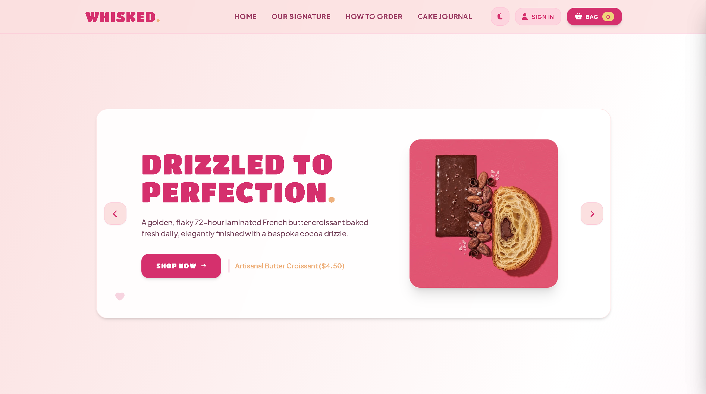
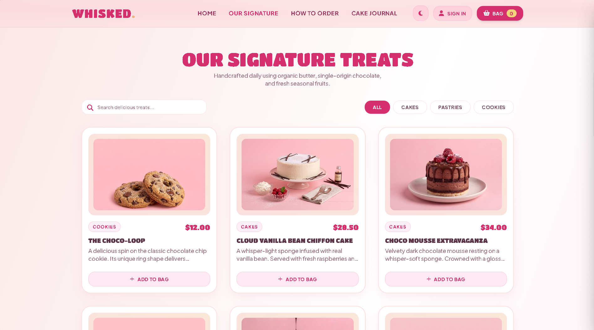
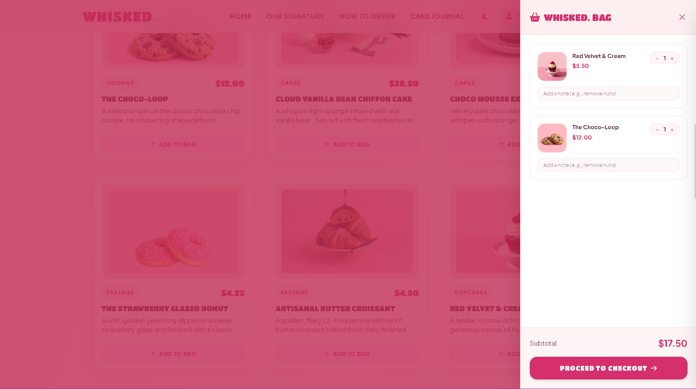
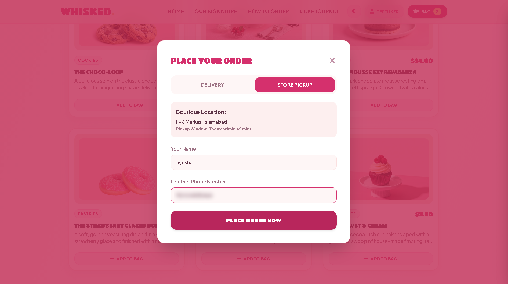
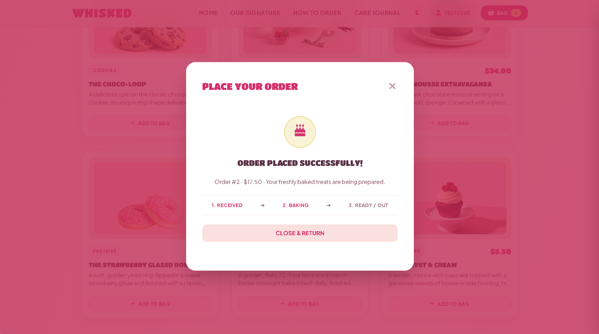

# Whisked. — Artisanal Bakery Storefront

A full-stack bakery web app: browse cakes, cookies and pastries, customize a cake
(size, message), sign in, place a delivery or pickup order, and track its status.

**Stack:** Django 5 (JSON API, session auth) · SQLite · HTML + Tailwind (CDN) + vanilla JavaScript



<p>
  
  
</p>
<p>
  
  
</p>

## Features
- Product catalogue with category filter and search
- Cake customization (size surcharge, message on cake or gift tag, per-item notes)
- Account registration, login and logout (Django sessions, CSRF protected)
- Delivery or pickup checkout; guest checkout supported
- Order tracking for signed-in users (Received → Baking → Ready → Completed)
- Django admin to manage products and update order status
- Prices are always calculated on the server, never trusted from the browser
- Dark mode, responsive layout

## Quick start

Requires Python 3.10+.

```bash
python -m venv .venv
source .venv/bin/activate          # Windows: .venv\Scripts\activate
pip install -r requirements.txt

cd backend
python manage.py migrate
python manage.py seed_products     # loads sample products
python manage.py createsuperuser   # optional: for /admin/
python manage.py runserver
```

Open http://127.0.0.1:8000/ (storefront) or http://127.0.0.1:8000/admin/.

Run the tests:

```bash
cd backend
python manage.py test
```

## API

| Method | Route | Description |
|---|---|---|
| GET | `/api/products/` | Active catalogue |
| POST | `/api/auth/register/` | Create account and sign in |
| POST | `/api/auth/login/` | Sign in |
| POST | `/api/auth/logout/` | Sign out |
| GET | `/api/auth/me/` | Current user (or `null`) |
| POST | `/api/orders/` | Place an order (guests must send `name`) |
| GET | `/api/orders/mine/` | Signed-in user's orders and status |

## Configuration

Environment variables (see `.env.example`):

| Variable | Default | Purpose |
|---|---|---|
| `DJANGO_DEBUG` | `true` | Set to `false` in production |
| `DJANGO_SECRET_KEY` | dev-only key | **Required** when debug is off |
| `DJANGO_ALLOWED_HOSTS` | `127.0.0.1,localhost` | Comma-separated hostnames |
| `DJANGO_SSL_REDIRECT` | `true` | Only applies when debug is off |

## Project structure

```
whisked-bakery/
├── index.html            Storefront (single page)
├── requirements.txt
├── .env.example
└── backend/
    ├── manage.py
    ├── whisked/          Project settings and URLs
    └── store/            Models, views, admin, tests, seed command
```

## Known limitations
- No online payment: orders are recorded and the bakery follows up.
- Cart lives in memory and is cleared on refresh.
- Product images are hotlinked from external sites and may break; host your own for real use.
- Tailwind is loaded from its CDN, which is meant for prototypes. Build it for production.
- No email notifications or login rate limiting yet.
